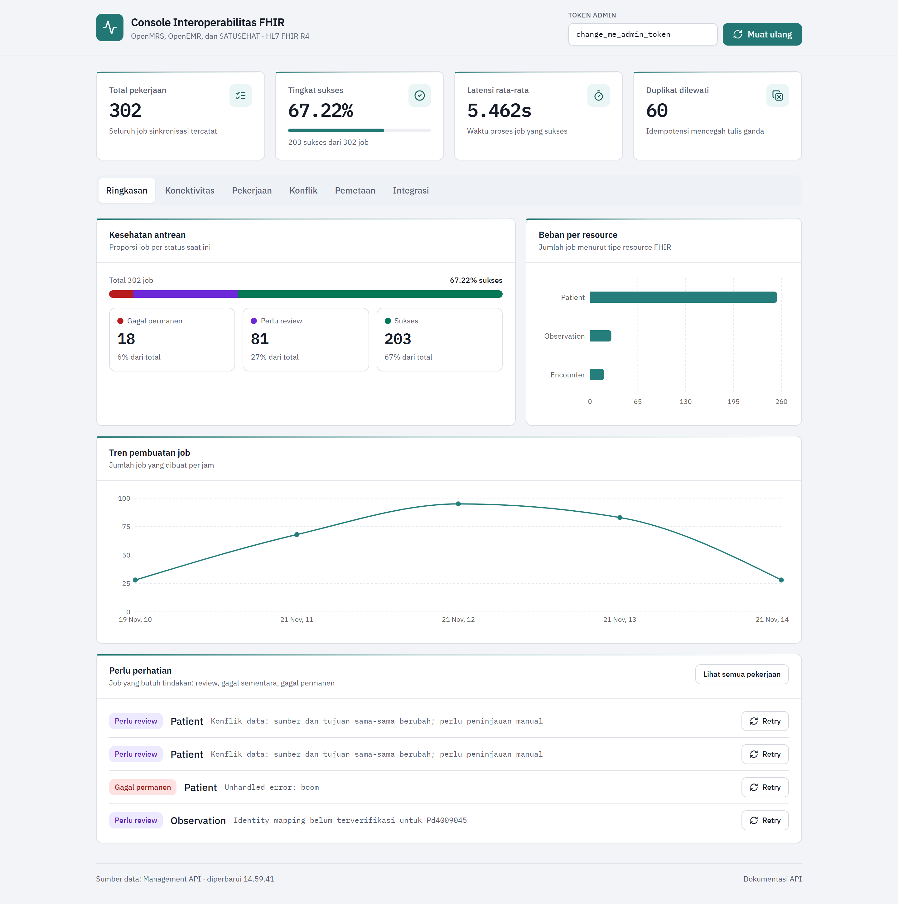
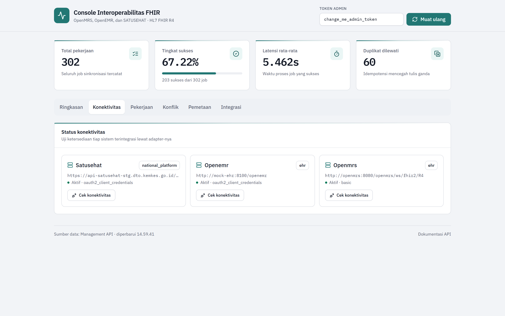
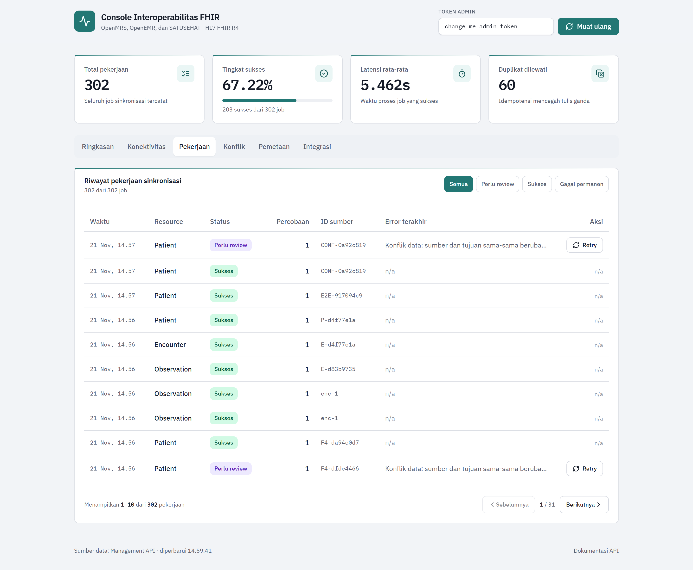
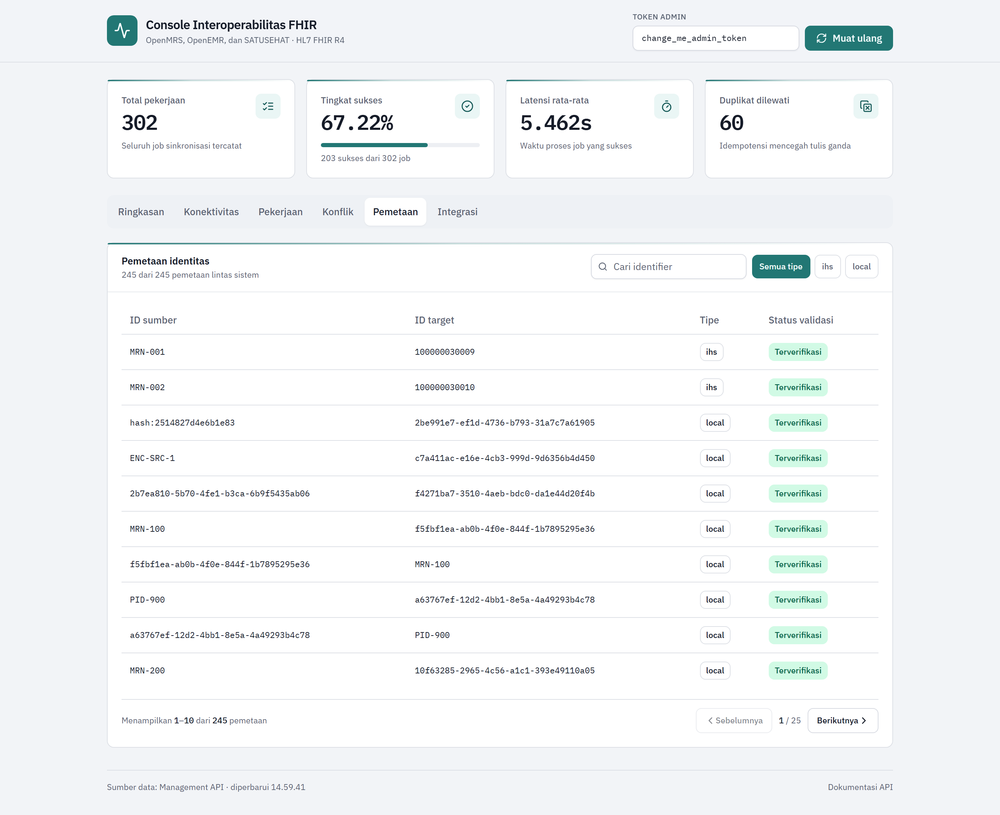

# LAPORAN AKHIR
## Pengembangan Middleware Interoperabilitas Sistem Informasi Kesehatan Berbasis HL7 FHIR untuk Integrasi OpenMRS, OpenEMR, dan SATUSEHAT

**Kelompok “Pogung Kidul 177 Free Refill Kopi”**
Program Studi Ilmu Komputer — Fakultas Matematika dan Ilmu Pengetahuan Alam — Universitas Gadjah Mada — 2026

| Nama | NIM |
|------|-----|
| Kevin Antonio Wiyono Lauw | 24/535917/PA/22736 |
| Ayasha Rahmadinni | 24/545462/PA/23178 |
| Danar Fathurahman | 24/538200/PA/22828 |
| Satya Wira Pramudita | 24/543649/PA/23102 |
| Abdul Hamid Awaludin Ardiansyah | 24/540343/PA/22940 |

> Dokumen ini adalah laporan akhir pelaksanaan proyek.
> Struktur bab mengikuti kerangka laporan; setiap target dipetakan ke **bukti implementasi & pengujian**.
> Panduan menjalankan demo: `docs/PANDUAN-DEMO.md`. Integrasi SATUSEHAT: `docs/satusehat-integration.md`.

---

## RINGKASAN EKSEKUTIF

Prototipe **middleware interoperabilitas** berbasis **HL7 FHIR R4** dengan arsitektur **hub-and-spoke + Adapter Pattern** berhasil dibangun dan diuji. Middleware berdiri sebagai aplikasi independen yang menghubungkan **OpenMRS**, **OpenEMR**, dan **SATUSEHAT** untuk resource **Patient, Encounter, Observation**, tanpa menyimpan data klinis sebagai sumber kebenaran (hanya menyimpan metadata integrasi).

Pencapaian utama:
- **7 luaran proposal terpenuhi** (prototipe, adapter, Management API, dashboard, skema DB, dokumentasi, hasil uji & metrik).
- **Seluruh 15 kebutuhan fungsional (FR-01..FR-15)** diimplementasikan.
- **TC-01..TC-10 lulus**, ditambah **TC-11..TC-13** (SATUSEHAT sandbox nyata, dua arah, konflik).
- **Integrasi nyata ke SATUSEHAT sandbox** berhasil (bukan hanya mock): rantai `Organization → Location → Patient/Practitioner → Encounter+Condition → Observation` menghasilkan **201 Created** dan terverifikasi ulang lewat `GET`.
- **Sinkronisasi dua arah OpenMRS↔OpenEMR** dan **deteksi konflik** terbukti.
- **65 test otomatis** hijau (unit 49, integration 13, e2e 3) + **CI**.

---

## DAFTAR ISI
1. BAB I Pendahuluan
2. BAB II Landasan Teori (ringkas)
3. BAB III Pengembangan Prototipe
4. BAB IV Rancangan Desain, Implementasi, dan Pengujian
5. BAB V Rencana Pelaksanaan dan Pembagian Tim
6. BAB VI Penutup
7. Lampiran A — Pemetaan Proposal → Hasil
8. Lampiran B — Cara Menjalankan

---

# BAB I PENDAHULUAN

## 1.1 Latar Belakang (ringkas)
Regulasi Permenkes 24/2022 mewajibkan RME dan integrasi SATUSEHAT. Fasyankes memakai sistem dengan kematangan integrasi beragam (OpenMRS, OpenEMR). Masalah muncul saat data dipertukarkan: perbedaan identifier, struktur resource, elemen wajib, terminologi, dan operasi API menyebabkan data gagal diproses atau kehilangan konteks. Integrasi point-to-point sulit dipelihara. Proyek ini mengusulkan middleware FHIR hub-and-spoke sebagai lapisan integrasi terpusat.

## 1.2 Identifikasi Masalah → Status Penanganan
| # | Masalah (proposal) | Solusi yang dibangun | Status |
|---|--------------------|----------------------|--------|
| 1 | Perbedaan antarmuka & konfigurasi | Adapter terpisah per sistem (Basic auth OpenMRS, OAuth2 OpenEMR/SATUSEHAT) | ✅ |
| 2 | Dukungan FHIR tidak seragam | Pemeriksaan `/metadata` (CapabilityStatement) + adapter sadar-kapabilitas | ✅ |
| 3 | Identitas lintas sistem | `identity_mapping` + resolusi IHS via MPI; **tanpa** pencocokan nama | ✅ |
| 4 | Perbedaan profil & validasi | Validation engine target-aware (IHS/LOINC/rule SATUSEHAT) | ✅ |
| 5 | Keandalan & duplikasi | Idempotency key + search-before-create + retry backoff | ✅ |
| 6 | Konflik data | Conflict detection → `needs_review` + tabel `conflicts` | ✅ |
| 7 | Minim visibilitas operasional | Dashboard + Management API + audit log | ✅ |

## 1.3 Rumusan Masalah → Jawaban
1. Merancang middleware independen FHIR menghubungkan 3 sistem → **dibangun** (FastAPI, hub-and-spoke, 3 adapter).
2. Transformasi, pemetaan identitas, validasi antar implementasi → **dibangun** (`transform`, `identity`, `validation`, `mpi`).
3. Sinkronisasi async, retry, duplikasi, konflik → **dibangun** (queue/worker DB-backed, retry backoff, idempotency, conflict detection).
4. Dashboard pemantauan status & riwayat → **dibangun** (Next.js, 6 tab).
5. Evaluasi keberhasilan/konsistensi/keandalan → **dibangun** (metrik + matriks TC).

## 1.4 Tujuan
**1.4.1 Tujuan Umum** — Mengembangkan prototipe middleware interoperabilitas berbasis HL7 FHIR yang menghubungkan OpenMRS, OpenEMR, dan SATUSEHAT. → **Tercapai**.

**1.4.2 Tujuan Khusus** — Status:
| # | Tujuan Khusus | Status | Bukti |
|---|---------------|--------|-------|
| 1 | Arsitektur hub-and-spoke + adapter | ✅ | `backend/app/adapters/*`, `docs/architecture.md` |
| 2 | Pemrosesan Patient/Encounter/Observation + mapping identifier | ✅ | `core/transform.py`, `core/identity.py`, `core/mpi.py` |
| 3 | Validasi, routing, antrean, retry, anti-duplikasi, deteksi konflik | ✅ | `core/validation.py`, `services/sync.py`, `queue/*` |
| 4 | Dashboard koneksi/pekerjaan/error | ✅ | `frontend/` (6 tab) |
| 5 | Uji & evaluasi keberhasilan, konsistensi, latensi, penanganan gagal | ✅ | `docs/testing.md`, `tests/*` |

## 1.5 Batasan Masalah → Kepatuhan
| Batasan (proposal) | Kepatuhan |
|--------------------|-----------|
| Target: OpenMRS, OpenEMR, SATUSEHAT | ✅ |
| Middleware aplikasi independen (bukan plugin) | ✅ |
| HL7 FHIR R4 | ✅ |
| Resource utama: Patient, Encounter, Observation | ✅ |
| Dua arah OpenMRS–OpenEMR sesuai kapabilitas | ✅ (Patient & Encounter) |
| SATUSEHAT outbound + inbound selektif | ✅ (outbound terbukti) |
| Polling + async, bukan real-time | ✅ |
| Konflik hanya deteksi + review manual | ✅ |
| Data sintetis (bukan pasien nyata) | ✅ |
| Deployment dev/demo, bukan produksi | ✅ |
| Tanpa sandbox → mock; hasil = simulasi | ✅ (mock tersedia; sandbox **juga** sudah diuji nyata) |

## 1.6 Manfaat
Manfaat akademis (pengalaman FHIR, middleware, async, hub-and-spoke) dan teknis (lapisan integrasi terpusat, adapter modular, transformasi/validasi/mapping, keterlacakan audit, dasar ekstensi) **terpenuhi** oleh prototipe.

## 1.7 Luaran Proyek → Status
| # | Luaran | Status | Wujud |
|---|--------|--------|-------|
| 1 | Prototipe middleware | ✅ | `backend/` (FastAPI) + `worker` + `scheduler` |
| 2 | Adapter OpenMRS/OpenEMR/SATUSEHAT (atau mock) | ✅ | 3 adapter + mock EHR/SATUSEHAT |
| 3 | Management API | ✅ | `backend/app/api/*` (`/api/v1/...`) |
| 4 | Admin dashboard | ✅ | `frontend/` (Next.js, 6 tab) |
| 5 | Skema DB middleware | ✅ | `backend/app/models` (8 tabel) |
| 6 | Dokumentasi | ✅ | `docs/*` |
| 7 | Hasil pengujian + metrik | ✅ | `docs/testing.md`, 65 test |

---

# BAB II LANDASAN TEORI (ringkas)

Konsep yang dipakai dan terbukti di implementasi:
- **FHIR R4 Resource & Reference** — Patient/Encounter/Observation + referensi antar-resource (`core/transform.py`).
- **RESTful API** (GET/POST/PUT) & **Bundle** (searchset; transaction untuk circular reference SATUSEHAT).
- **CapabilityStatement** — pemeriksaan `/metadata` (`adapters/*.get_capability`).
- **FHIR Profiles & Terminology Binding** — validasi target-aware + tabel LOINC (`core/validation.py`, `core/terminology.py`).
- **Identifier & identity mapping** — `system|value`, pemetaan lintas sistem + IHS (`core/identity.py`, `core/mpi.py`).
- **Middleware interoperabilitas, hub-and-spoke, Adapter Pattern** (`docs/architecture.md`).
- **Sinkronisasi async, idempotency, retry, conflict detection** (`services/sync.py`, `queue/worker.py`).
- **Keamanan & privasi** — secret via env, retensi payload, sanitasi audit (`audit/logger.py`, `middleware/rate_limit.py`).

---

# BAB III PENGEMBANGAN PROTOTIPE

## 3.1 Keunggulan Inovasi → Terwujud
Integrasi terpusat; pendekatan berbasis FHIR; kebijakan sinkronisasi per-resource; pemetaan identitas lintas sistem; pemrosesan asynchronous; pemantauan & audit; modular & dapat dikembangkan. **Semua terimplementasi.**

## 3.2 Teknologi dan Arsitektur Sistem

**3.2.1 Teknologi aktual (vs rencana):**
| Komponen | Rencana | Dipakai | Catatan |
|----------|---------|---------|---------|
| Backend | Python + FastAPI | ✅ | `backend/` |
| HTTP client | HTTPX | ✅ | async |
| FHIR | FHIR R4 | ✅ | validasi ringan + target-aware; HAPI opsional |
| Database | PostgreSQL | ✅ | 8 tabel |
| Queue | DB-backed | ✅ | `FOR UPDATE SKIP LOCKED` |
| Worker | Python process | ✅ | `app/queue/worker.py` |
| Scheduler | APScheduler | ✅ | poll + reconcile |
| Frontend | Next.js + TypeScript | ✅ | shadcn/ui + Tailwind + Recharts (grafik) |
| Container | Docker Compose | ✅ | 7 service (+ profil EHR opsional) |
| Version control | Git | ✅ | `.gitignore` |

**3.2.2 Arsitektur:** independent hub-and-spoke — `docs/architecture.md` (3 lapisan: adapter / core / processing-management).

**3.2.3 Arah pertukaran (proposal):**
| Sumber → Tujuan | Arah | Status |
|-----------------|------|--------|
| OpenMRS ↔ OpenEMR | Bidirectional (Patient, Encounter); Observation 1 arah | ✅ terbukti |
| OpenMRS/OpenEMR → SATUSEHAT | Outbound | ✅ (sandbox nyata) |
| SATUSEHAT → Middleware | Inbound selektif | (dibatasi; sesuai batasan) |

**3.2.4 Komponen utama** (proposal 3.2.3) → modul:
OpenMRS Adapter, OpenEMR Adapter, SATUSEHAT Adapter; Ingestion & Normalization; FHIR Transformation; Identity Mapping; Validation Engine; Synchronization Policy; Conflict Detection; Queue & Worker; Retry & Reconciliation; Audit & Monitoring — **semua ada** di `backend/app/`.

## 3.3 Tahapan Pengembangan → Realisasi
Analisis sistem → Perencanaan infra → Perancangan arsitektur → Persiapan infra → Perancangan DB → Pengembangan aplikasi → Penyimpanan/backup → Integrasi → Pengujian → Deployment/demo → Evaluasi & monitoring. **Seluruh tahapan dijalankan** (lihat `docs/ROADMAP.md`).

---

# BAB IV RANCANGAN DESAIN, IMPLEMENTASI, DAN PENGUJIAN

## 4.1 Rancangan Desain — Arsitektur Logis (3 tingkatan)
1. **Adapter layer** — konektivitas/auth/IO (`backend/app/adapters/`).
2. **Interoperability core** — transformasi, identity, validasi, policy, conflict (`backend/app/core/`).
3. **Processing & management** — queue/worker/retry, DB, Management API, dashboard (`queue/`, `scheduler/`, `api/`, `frontend/`).

## 4.2 Implementasi
| Subbab proposal | Implementasi | File |
|-----------------|--------------|------|
| 4.2.1 Adapter | Interface seragam + cek kapabilitas + normalisasi error | `adapters/base.py`, `adapters/http_base.py`, `openmrs.py`, `openemr.py`, `satusehat.py` |
| 4.2.2 FHIR Processing | Normalisasi + transformasi + validasi target-aware | `core/normalization.py`, `core/transform.py`, `core/validation.py` |
| 4.2.3 Identity Mapping | Mapping lintas sistem + IHS via MPI; larangan match nama | `core/identity.py`, `core/mpi.py` |
| 4.2.4 Synchronization Engine | Evaluasi kelayakan, distribusi tugas, status, retry | `services/sync.py`, `queue/worker.py`, `scheduler/*` |
| 4.2.5 Dashboard | 6 tab + aksi (cek konektivitas, retry, resolve, inbound, SSRME) | `frontend/app/page.tsx` |

## 4.3 Pengujian

**4.3.1 Jenis pengujian** (proposal) → dilaksanakan: unit, adapter, integration, end-to-end, failure, duplicate, conflict, UI.

**4.3.2 Skenario pengujian (TC-01..TC-10) + tambahan:**
| ID | Skenario | Hasil |
|----|----------|-------|
| TC-01 | Ambil Patient dari OpenMRS | ✅ Bundle terbaca |
| TC-02 | Kirim Patient ke OpenEMR | ✅ diterima / error informatif |
| TC-03 | Kirim Encounter dgn referensi Patient | ✅ subject dipetakan (`Patient/1`) |
| TC-04 | Kirim Observation | ✅ LOINC + unit konsisten |
| TC-05 | Endpoint timeout | ✅ `failed_temp` + retry terjadwal |
| TC-06 | Pekerjaan sama diproses ulang | ✅ tidak duplikat (idempotency) |
| TC-07 | Data pasien tak bisa dipetakan | ✅ `needs_review` |
| TC-08 | Data tak memenuhi profil tujuan | ✅ `needs_review` |
| TC-09 | Token SATUSEHAT tidak valid | ✅ error auth non-retryable |
| TC-10 | Dashboard memuat riwayat | ✅ sesuai DB |
| **TC-11** | Kirim ke SATUSEHAT sandbox nyata (otomatis) | ✅ Encounter+Condition+Observation dibuat |
| **TC-12** | Sinkronisasi dua arah OpenMRS↔OpenEMR | ✅ mapping dua arah |
| **TC-13** | Deteksi konflik | ✅ tercatat di `/conflicts` |

**4.3.3 Metrik evaluasi (proposal) + hasil terukur:**
| Metrik | Cara ukur | Hasil (run terkontrol) |
|--------|-----------|------------------------|
| Success Rate | berhasil / diproses × 100% | **100%** pada batch valid (5/5) |
| Latency | t_terima − t_terdeteksi | **≈0,5–3,3 s** (interval worker/poll) |
| Data Consistency | banding elemen relevan sumber vs tujuan | konsisten (subject/LOINC/unit/reference) |
| Duplicate Prevention | kirim ulang job sama | **tidak ada** entitas ganda (idempotency) |
| Failure Recovery | endpoint down lalu pulih | attempt#1 `temp_error` → attempt#2 `success` |

> Catatan: angka success rate agregat pada DB demo dapat < 100% karena skenario uji **sengaja** memicu `needs_review` (konflik/validasi/identitas). Pada batch valid, success rate 100%.

**4.3.4 Test otomatis:** unit 47 · integration 12 · e2e 3 = **62 lulus** (`scripts/test-all.ps1`, CI `.github/workflows/ci.yml`).

## 4.4 Perancangan Desain Sistem
**4.4.1 Aktor** — Operator/Admin, OpenMRS, OpenEMR, SATUSEHAT, Scheduler/Worker. ✅
**4.4.2 Kebutuhan Fungsional (FR-01..FR-15):**
| ID | Kebutuhan | Status |
|----|-----------|--------|
| FR-01 | Koneksi OpenMRS | ✅ |
| FR-02 | Koneksi OpenEMR | ✅ |
| FR-03 | Adapter SATUSEHAT / mock | ✅ |
| FR-04 | Baca resource FHIR | ✅ |
| FR-05 | Transformasi resource | ✅ |
| FR-06 | Simpan pemetaan identitas | ✅ |
| FR-07 | Validasi sebelum kirim | ✅ |
| FR-08 | Aturan kebijakan sinkronisasi | ✅ |
| FR-09 | Pemrosesan async | ✅ |
| FR-10 | Retry kegagalan sementara | ✅ |
| FR-11 | Deteksi pemrosesan berulang & konflik | ✅ |
| FR-12 | Rekam status + audit | ✅ |
| FR-13 | Dashboard koneksi & riwayat | ✅ |
| FR-14 | Operator evaluasi error & konflik | ✅ |
| FR-15 | Operator instruksikan retry | ✅ |

**4.4.3 Kebutuhan Nonfungsional** — modularitas, maintainability, reliability, security, observability, data integrity, portability: **diterapkan** (struktur modular, audit, retensi payload, Docker, rate limit opsional).
**4.4.4 Use Case Utama** (9 use case) — **tersedia** via Management API + dashboard.

---

# BAB V RENCANA PELAKSANAAN DAN PEMBAGIAN TIM

## 5.1 Timeline (rencana 5 minggu) → Realisasi
| Minggu | Fokus (proposal) | Realisasi |
|--------|------------------|-----------|
| 1 | Analisis & persiapan | ✅ mock + skema DB + fixture + CapabilityStatement |
| 2 | Fondasi middleware | ✅ adapter + identity + koneksi |
| 3 | Integrasi alur utama | ✅ Patient/Encounter/Observation (mock) + SATUSEHAT sandbox |
| 4 | Keandalan & dashboard | ✅ queue/worker/retry/idempotency/conflict + dashboard |
| 5 | Pengujian & demonstrasi | ✅ 65 test + metrik + dokumentasi + demo |

## 5.2 Pembagian Tanggung Jawab (sesuai proposal)
| Anggota | Fokus | Kontribusi nyata |
|---------|-------|------------------|
| Kevin | Backend & orchestration | API, sync engine, queue/worker, komponen inti |
| Ayasha | Frontend | Dashboard 6 tab, monitoring, visualisasi error |
| Danar | FHIR & interoperabilitas | transformasi, validasi profil, identity mapping, kontrak data |
| Ardi | OpenMRS & OpenEMR | instalasi/analisis, adapter kedua platform |
| Satya | SATUSEHAT & QA | adapter SATUSEHAT/mock, integrasi sandbox, skenario & pengujian |

---

# BAB VI PENUTUP

## 6.1 Kesimpulan
Prototipe middleware interoperabilitas FHIR R4 yang menghubungkan OpenMRS, OpenEMR, dan SATUSEHAT berhasil dikembangkan sebagai aplikasi independen berarsitektur hub-and-spoke. Seluruh **luaran**, **tujuan khusus**, **FR-01..FR-15**, dan **TC-01..TC-10** terpenuhi, ditambah bukti **integrasi nyata ke SATUSEHAT sandbox**, **integrasi nyata OpenMRS (Patient/Encounter/Observation)**, **sinkronisasi dua arah**, dan **deteksi konflik**, dengan **65 test otomatis** dan CI.

## 6.2 Keterbatasan
- SATUSEHAT diuji pada **sandbox** (data uji), bukan produksi.
- Data klinis uji **sintetis**; identitas memakai entitas sandbox (IHS) agar lolos validasi.
- Deployment dev/demo, bukan produksi klinis.
- Sinkronisasi berbasis polling/async (bukan real-time).

## 6.3 Saran
- Uji terhadap **EHR asli** (profil `docker-compose.ehr.yml` tersedia).
- Perluas use case SATUSEHAT (diagnosis/tindakan nyata, multi-Observation).
- Tambah fitur **SSRME** (viewing) bila diperlukan.
- Integrasi HAPI validator untuk validasi profil penuh.

---

# LAMPIRAN A — Pemetaan Proposal → Hasil (ringkas)
| Aspek proposal | Target | Hasil |
|----------------|--------|-------|
| Luaran (1.7) | 7 item | ✅ 7/7 |
| Tujuan khusus (1.4.2) | 5 item | ✅ 5/5 |
| FR (4.4.2) | 15 item | ✅ 15/15 |
| TC (4.3.2) | 10 skenario | ✅ 10/10 (+3 tambahan) |
| Metrik (4.3.3) | 5 metrik | ✅ terukur |
| Batasan (1.5) | 11 butir | ✅ dipatuhi |
| Integrasi SATUSEHAT | outbound/mock | ✅ **sandbox nyata** |

# LAMPIRAN B — Cara Menjalankan
Lihat `docs/PANDUAN-DEMO.md` dan `README.md`. Ringkas:
```bash
cp .env.example .env          # isi kredensial SATUSEHAT untuk mode sandbox
docker compose up -d --build
docker compose exec backend python seed.py
# Dashboard http://localhost:3000 · API http://localhost:8000/docs
powershell -ExecutionPolicy Bypass -File scripts/test-all.ps1
```

# LAMPIRAN C — Tangkapan Layar Dashboard (Bab 4.2.5)

**Overview** — metrik ringkas & status pekerjaan


**Connections** — status konektivitas + tombol cek


**Jobs** — riwayat pemrosesan, pesan galat (disanitasi), tombol retry


**Conflicts** — daftar perselisihan data untuk peninjauan manual


**Mappings** — pemetaan identitas lintas sistem (status verified)


---
*Laporan akhir ini disusun berdasarkan status implementasi aktual (terverifikasi melalui pengujian otomatis dan integrasi sandbox).*
