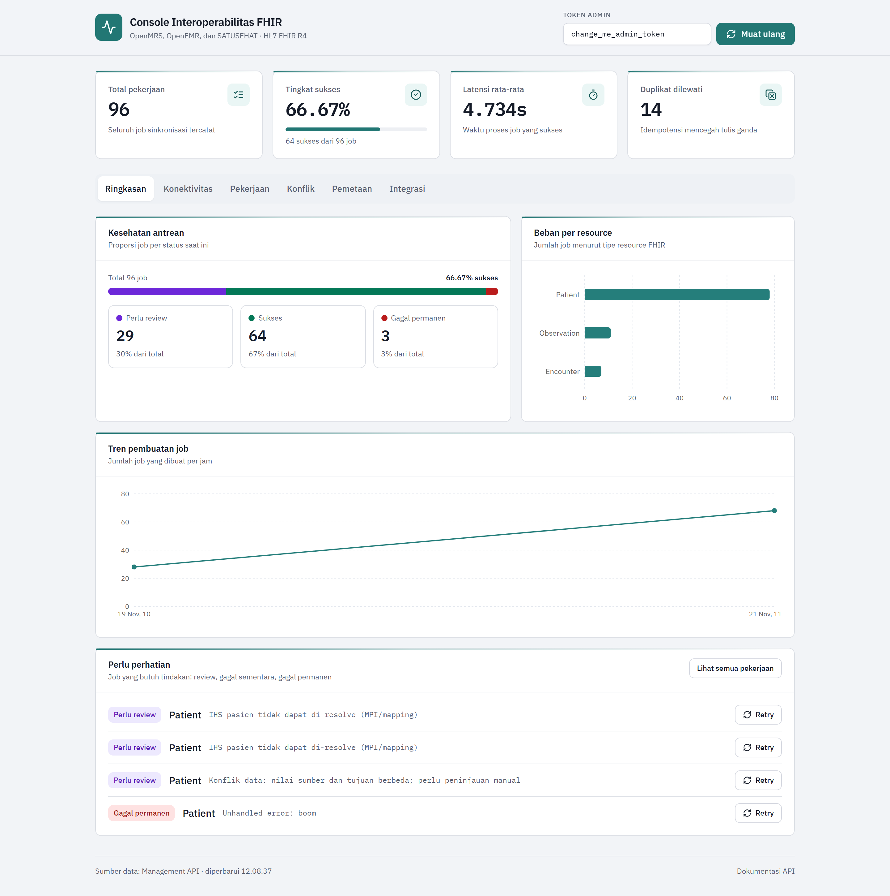
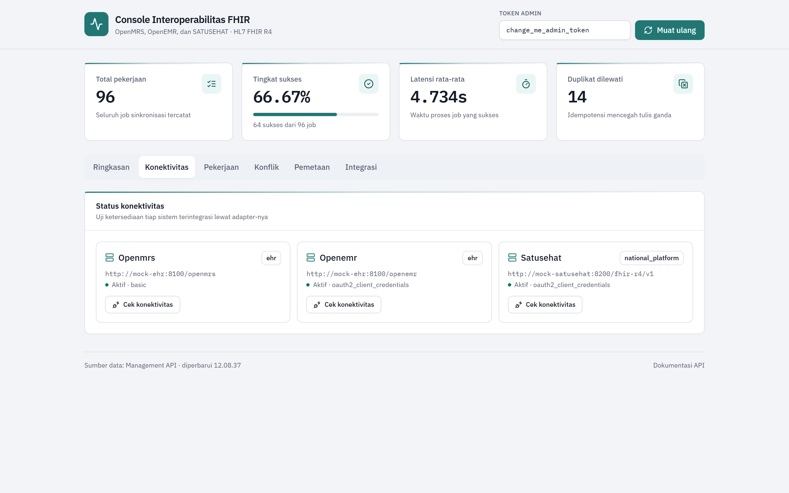
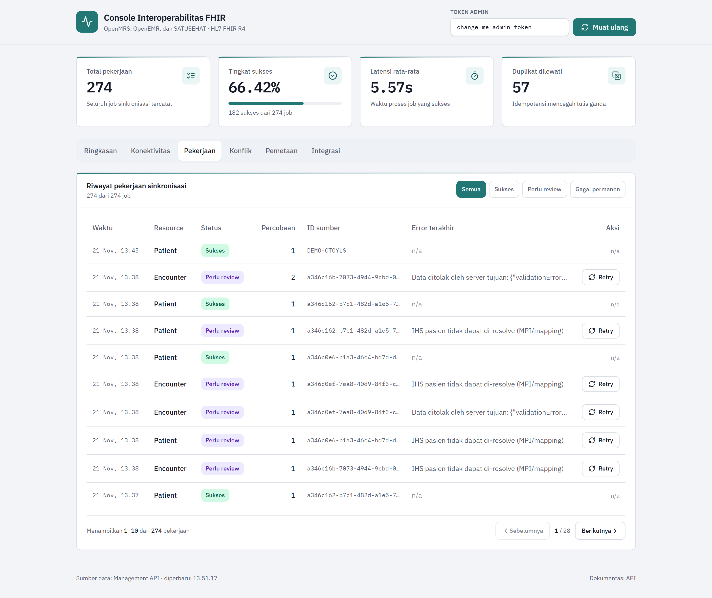
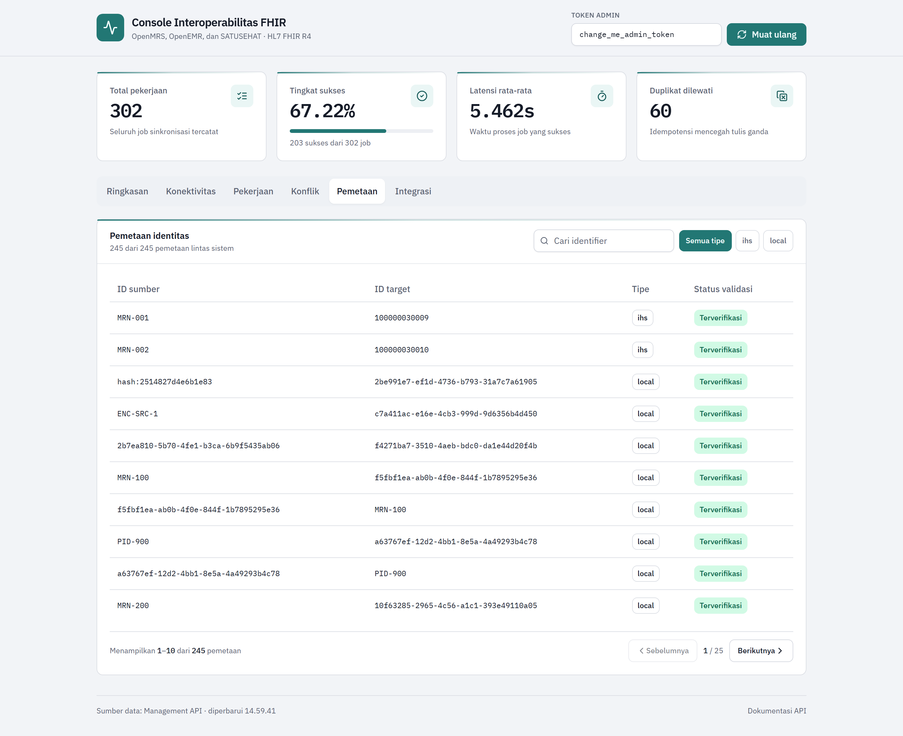
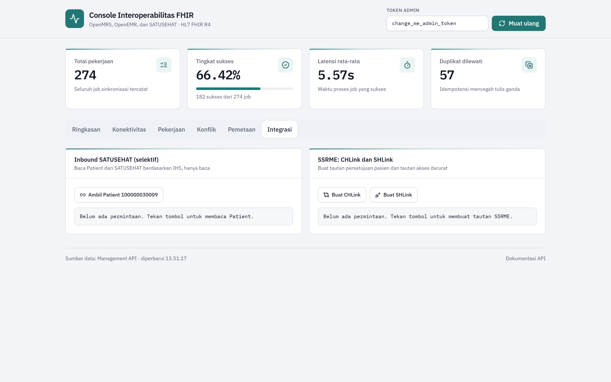
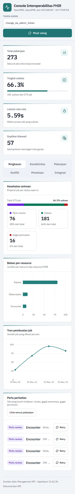

# PANDUAN DEMO — Middleware Interoperabilitas HL7 FHIR

Panduan operasional untuk mendemonstrasikan prototipe di depan penguji/dosen.
Durasi total ±15–20 menit. Semua perintah dijalankan dari **root repo**
(`G:\Project\Kuliah\Kapsel RPLD`).

> Struktur & target mengikuti proposal. Untuk detail integrasi SATUSEHAT: `docs/satusehat-integration.md`.

---

## 0. Persiapan (sekali)

**Prasyarat:** Docker Desktop aktif, PowerShell.

1. Siapkan konfigurasi:
```powershell
Copy-Item .env.example .env
```
2. Isi `.env` (khusus demo SATUSEHAT sandbox):
```
SATUSEHAT_MODE=sandbox
SATUSEHAT_ORG_ID=<Organization IHS id>
SATUSEHAT_CLIENT_ID=<client id>
SATUSEHAT_CLIENT_SECRET=<client secret>
```
> 🔒 **Jangan pernah menampilkan/meng-commit `client_secret`.** File `.env` sudah di `.gitignore`.
> Untuk demo **tanpa internet/kredensial**, set `SATUSEHAT_MODE=mock`.

3. Jalankan seluruh stack + seed:
```powershell
docker compose up -d --build
docker compose exec backend python seed.py
```

**Cek siap:**
```powershell
docker compose ps
curl http://localhost:8000/health
```

---

## 1. Peta URL (titik tunjuk)

| Layanan | URL | Untuk menunjukkan |
|---------|-----|-------------------|
| Dashboard | http://localhost:3000 | Overview, Connections, Jobs, Conflicts, Mappings |
| Management API (Swagger) | http://localhost:8000/docs | FR-01..FR-15, metrik |
| Mock EHR (OpenMRS/OpenEMR) | http://localhost:8100 | data tujuan hasil sinkronisasi |
| Mock SATUSEHAT | http://localhost:8200 | data tujuan SATUSEHAT (mode mock) |

Admin token default: `change_me_admin_token` (di `.env`).

> **Dua mode demo:**
> - **Mode MOCK** (`SATUSEHAT_MODE=mock`) → untuk Skenario A/B/C/E/F (aman, tanpa transaksi nyata).
> - **Mode SANDBOX** (`SATUSEHAT_MODE=sandbox`) → khusus Skenario D (integrasi nyata).
> Ganti mode: edit `.env` lalu `docker compose up -d --force-recreate backend worker scheduler`.
> Untuk demo yang aman & bersih, jalankan Skenario A–C pada **mode mock**, lalu Skenario D pada **mode sandbox**.

---

## 2. Skenario A — Alur inti (mock): Patient/Encounter/Observation → OpenEMR & SATUSEHAT
**Tujuan:** menunjukkan luaran #1–#4 + FR inti (transform, identity, validasi, sinkronisasi).
**Prasyarat:** `SATUSEHAT_MODE=mock` (lihat “Dua mode demo” di atas).

```powershell
powershell -ExecutionPolicy Bypass -File scripts/demo.ps1
```
Yang ditunjukkan skrip:
- Enqueue 5 job (Patient/Encounter/Observation → OpenEMR & SATUSEHAT mock).
- Tabel **status job** (`success`) — bukti queue/worker.
- **Metrik** (success rate, latency, duplicate skips).
- Data di target: OpenEMR `Encounter.subject → Patient/1` (hasil identity mapping), SATUSEHAT `Observation` dengan **LOINC 8310-5** & **IHS**.

**Narasi:** “Middleware memetakan identitas, mentransformasi resource ke profil tujuan, memvalidasi, lalu mengirim via worker; status & error tercatat.”

---

## 3. Skenario B — Dashboard (FR-13/14/15)
Buka http://localhost:3000 (UI **shadcn/ui + Tailwind + Recharts**, responsif, lolos audit antislop), tunjukkan 6 tab:
1. **Ringkasan** — 4 kartu metrik, **bar kesehatan antrean** per status, bar *beban per resource*, **tren job per jam**, dan daftar **Perlu perhatian** dengan tombol Retry.
2. **Konektivitas** — kartu 3 sistem + tombol **Cek konektivitas** (klik → status `HTTP 200`/error inline).
3. **Pekerjaan** — riwayat job + filter status + tombol **Retry** untuk `needs_review/failed_temp/failed_perm`.
4. **Konflik** — kartu konflik + tombol **Tandai selesai** (resolve manual).
5. **Pemetaan** — pemetaan identitas lintas sistem + pencarian & filter tipe identifier.
6. **Integrasi** — **Inbound SATUSEHAT** (baca Patient by IHS) dan **SSRME CHLink/SHLink**.

**Tangkapan layar (lampiran):**
| Tab | Gambar |
|-----|--------|
| Ringkasan |  |
| Konektivitas |  |
| Pekerjaan |  |
| Konflik |  |
| Pemetaan |  |
| Integrasi |  |
| Mobile (390px) |  |

> Screenshot dibuat otomatis via `scripts/screenshots/shoot.js` (puppeteer-core + Chrome headless; sekaligus mengecek overflow di viewport mobile).
> Regenerate: `cd scripts/screenshots && node shoot.js` (butuh dashboard hidup di :3000).

---

## 4. Skenario C — Sinkronisasi DUA ARAH + Deteksi Konflik (TC-12/TC-13)
```powershell
$t="change_me_admin_token"; $h=@{Authorization="Bearer $t";"Content-Type"="application/json"}
function Enq($s,$tg,$r,$v){ $b=@{source_system=$s;target_system=$tg;resource=$r;version=$v}|ConvertTo-Json -Depth 12; (Invoke-RestMethod -Method Post -Headers $h http://localhost:8000/api/v1/jobs/enqueue -Body $b).status }

# arah maju
Enq "openmrs" "openemr" @{resourceType="Patient";identifier=@(@{system="http://openmrs.org/mrn";value="DEMO-1"});name=@(@{family="Maju"});gender="male"} "v1"
# arah balik (OpenEMR -> OpenMRS)
Enq "openemr" "openmrs" @{resourceType="Patient";identifier=@(@{system="http://openemr.org/pid";value="PID-DEMO"});name=@(@{family="Balik"});gender="female"} "v1"
# konflik: ubah nilai yang sama setelah tersinkron
Enq "openmrs" "openemr" @{resourceType="Patient";identifier=@(@{system="http://openmrs.org/mrn";value="DEMO-1"});name=@(@{family="Berubah"});gender="male"} "v2"
Start-Sleep 10
docker compose exec -T db psql -U middleware -d middleware -c "SELECT status,left(last_error,45) FROM sync_jobs ORDER BY created_at;"
curl -H "Authorization: Bearer $t" http://localhost:8000/api/v1/conflicts
```
**Tunjuk:** job konflik = `needs_review`, dan entri muncul di **/conflicts** (dan tab Conflicts dashboard).

---

## 5. Skenario D — SATUSEHAT Sandbox NYATA (bukti integrasi sungguhan)
> Hanya jika `SATUSEHAT_MODE=sandbox` dan kredensial terisi.

**(D1) Rantai penuh manual (reproducible):**
```powershell
docker compose exec backend python probe_satusehat.py
```
Output yang ditunjukkan: `[OK] token → Organization → Patient → Practitioner → Location → 201 Encounter → 201 Condition → [OK] Observation`.

**(D2) Jalur otomatis via worker:**
```powershell
$t="change_me_admin_token"; $h=@{Authorization="Bearer $t";"Content-Type"="application/json"}
$enc=@{resourceType="Encounter";id="ENC-DEMO-1";status="finished";subject=@{reference="Patient/MRN-001"}}
(Invoke-RestMethod -Method Post -Headers $h http://localhost:8000/api/v1/jobs/enqueue -Body (@{source_system="openmrs";target_system="satusehat";resource=$enc}|ConvertTo-Json -Depth 12)).status
Start-Sleep 15
$obs=@{resourceType="Observation";status="final";code=@{text="body_temp"};subject=@{reference="Patient/MRN-001"};encounter=@{reference="Encounter/ENC-DEMO-1"};valueQuantity=@{value=36.9;unit="Cel"}}
(Invoke-RestMethod -Method Post -Headers $h http://localhost:8000/api/v1/jobs/enqueue -Body (@{source_system="openmrs";target_system="satusehat";resource=$obs}|ConvertTo-Json -Depth 12)).status
Start-Sleep 15
docker compose exec -T db psql -U middleware -d middleware -c "SELECT resource_type,status FROM sync_jobs ORDER BY created_at;"
```
**Narasi:** “Encounter dikirim sebagai transaction Bundle (Encounter+Condition) untuk memenuhi relasi wajib SATUSEHAT; mapping Encounter disimpan; Observation merujuk Encounter hasil mapping. Semua **201 Created** dan terverifikasi GET.”

> Catatan: `MRN-001` sudah dipetakan ke IHS sandbox `100000030009` oleh `seed.py`.

---

## 6. Skenario E — Keandalan: Retry & Failure Recovery (TC-05)
```powershell
docker compose stop mock-satusehat     # matikan target
# enqueue job ke satusehat (mode mock) -> akan failed_temp lalu retry
# (atau gunakan skenario apa pun yang menargetkan satusehat mock)
Start-Sleep 25
docker compose exec -T db psql -U middleware -d middleware -c "SELECT status,attempt_count FROM sync_jobs ORDER BY created_at DESC LIMIT 3;"
docker compose start mock-satusehat     # pulihkan -> retry sukses
Start-Sleep 35
docker compose exec -T db psql -U middleware -d middleware -c "SELECT status,attempt_count FROM sync_jobs ORDER BY created_at DESC LIMIT 3;"
```
**Tunjuk:** `failed_temp` → `success` setelah pulih (attempt#2).

---

## 7. Skenario F — Pengujian Otomatis (ringkas saat presentasi)
```powershell
docker compose stop scheduler
powershell -ExecutionPolicy Bypass -File scripts/test-all.ps1
docker compose start scheduler
```
Hasil: **unit 47 · integration 12 · e2e 3 = 62 passed**.

---

## 8. Reset antar sesi demo
```powershell
docker compose exec db psql -U middleware -d middleware -c "TRUNCATE sync_jobs, job_attempts, conflicts, audit_log RESTART IDENTITY CASCADE;"
docker compose restart mock-ehr mock-satusehat
docker compose exec backend python seed.py
```

---

## 9. Troubleshooting cepat
| Gejala | Solusi |
|--------|--------|
| Port 5432/8000/3000 dipakai | ubah mapping host di `docker-compose.yml` |
| Dashboard blank | tunggu Next.js dev (~20 s) lalu refresh |
| Job `needs_review` | wajar untuk konflik/validasi/identitas — tunjukkan sebagai fitur |
| SATUSEHAT error auth | cek kredensial/`SATUSEHAT_MODE`; jangan retry token berlebihan |
| Worker tak proses | `docker compose build backend && docker compose up -d worker` |

---

## 10. Checklist “lulus demo”
- [ ] Stack naik, `/health` OK, dashboard HTTP 200.
- [ ] Skenario A: 5 job `success`, data muncul di target.
- [ ] Skenario B: 5 halaman dashboard + cek konektivitas + retry.
- [ ] Skenario C: dua arah + konflik tercatat.
- [ ] Skenario D: SATUSEHAT sandbox 201 Created (probe & otomatis).
- [ ] Skenario E: failed_temp → success.
- [ ] Skenario F: 83 test passed.
